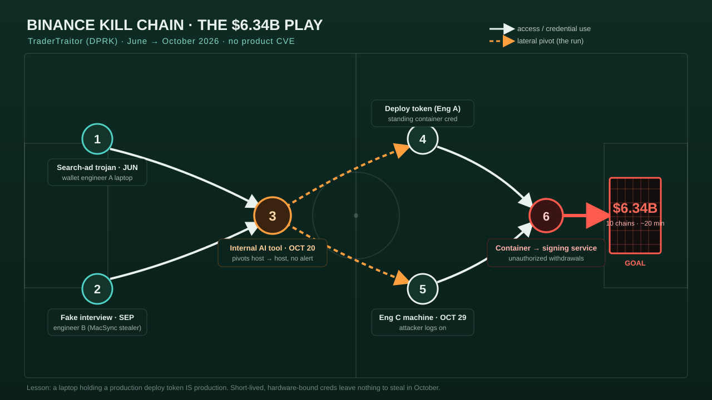

# Case 01 — The Binance $6.34B Heist (TraderTraitor / DPRK)

## Snapshot

| Field | Value |
|---|---|
| Drain date | 29 October 2026, ~17:15–19:56 UTC |
| Amount | ~$6.34 billion across 10 blockchains, in ~20 minutes of signing |
| Attribution | DPRK **TraderTraitor** (Lazarus-associated); FBI/USSS/IRS-CI alert 31 Oct; TRM Labs "high confidence"; Chainalysis, Elliptic concur |
| Root cause | Compromised developer/DevOps workstations + standing container-deploy token + abuse of an internal AI tool for lateral movement |
| Product CVE involved | **None.** This was identity, workstation trust, and process failure |
| Status | ~$2.85B frozen/intercepted; Binance says 98% of affected assets replaced; customers made whole |

> **Largest digital-asset theft on record** — surpassing the February 2025 Bybit theft, also attributed to TraderTraitor.

## What happened

This is the defining "trust" story of Black October. The attackers did not break Binance's cryptography or exploit a web vulnerability. They spent roughly **five months** living on the laptops of three wallet/DevOps engineers, then used access those laptops legitimately held.

Reconstructed timeline (Binance's own post-incident report + Palo Alto Networks Unit 42 + press):

- **June 2026 — Entry point A (poisoned tool).** A wallet engineer installed a trojanized developer tool — described as a Homebrew-style installer found via a **search engine ad** — on a work machine. The laptop fell quietly, no alert raised.
- **September 2026 — Entry point B (fake interview).** TraderTraitor ran a **"contagious interview"** spear-phish against a second engineer: a fake job offer with a coding "assignment" that delivered the MacSync/stealer dependency. Binance says it blocked 57 DPRK-linked attempts across 2026; this was the one that landed.
- **20 October 2026 — Lateral movement via an internal AI tool.** From the second engineer's machine, the attackers abused an **internal, permissioned AI developer tool** running on workstations to gain control of two more machines — including Engineer A's (the June victim) and a third wallet engineer (Engineer C). The AI tool let them hop between machines **without tripping standard security alerts**. Binance has not explained exactly how the AI tool was abused — the single biggest gap in the public report.
- **On Engineer A's machine:** a **container deployment permission token** — a standing credential that could deploy workloads into the environment.
- **29 October 2026 — The drain.** Between 17:15 and 19:56 UTC the attackers logged onto Engineer C's machine, used Engineer A's stolen deploy credential to **deploy a container**, and ran a script that reached Binance's internal **wallet signing service**, submitting unauthorized withdrawals. ~$6.34B moved across 10 chains.
- **31 October 2026 — Attribution.** FBI/USSS/IRS-CI joint alert attributes to TraderTraitor and urges providers to block the identified addresses. (On 3 Nov, DPRK's Kim Yo Jong denied involvement.)

## The play, on the board

  

## Attack chain → MITRE ATT&CK

| Phase | Technique | ID |
|---|---|---|
| Initial access (A) | Drive-by/trojanized installer via search-engine ad | T1189 / T1195.002 |
| Initial access (B) | Spear-phishing via fake job ("contagious interview") | T1566.003 |
| Execution | Malicious dependency / coding assignment runs on host | T1204.002 |
| Credential access | Theft of deploy token from engineer workstation | T1552.001 |
| Lateral movement | Abuse of internal AI developer tool to pivot host→host | T1210 / T1570 (tooling abuse) |
| Defense evasion | Movement via a trusted internal tool, below alert thresholds | T1550 / T1078 (valid accounts) |
| Execution (impact) | Container deployment → script → signing-service call | T1610 / T1059 |
| Impact | Unauthorized withdrawals / theft of funds | T1657 (financial theft) |

## Why it worked (root cause for defenders)

1. **A standing, reusable deploy token lived on a laptop.** Short-lived, hardware-bound (e.g., HSM/TPM or WebAuthn-gated, per-deploy) credentials would have left **nothing useful** on Engineer A's machine in October. This is the single highest-leverage fix.
2. **The developer workstation was effectively part of production** but almost certainly not monitored like production.
3. **An internal AI agent with workstation reach became a lateral-movement highway** that security tooling implicitly trusted.
4. **Signing was reachable from a deployed container** without an out-of-band human approval bound to the transaction.

## Indicators of compromise

TraderTraitor blockchain addresses are enumerated in the **FBI/USSS/IRS-CI 31 Oct alert** — pull them from IC3 and push to your chain-analytics/blocklists rather than copying a stale subset here (they are being added to as laundering continues). Behavioral indicators that generalize:

- `npm`/`pip`/Homebrew installs sourced from search-ad domains rather than canonical registries.
- Developer-tool "take-home assignments" executed on corporate endpoints.
- An internal automation/AI agent authenticating to, or executing on, hosts outside its normal scope.
- Container deploys originating from an interactive engineer session rather than CI.

## Detection & hunting

- **EDR:** alert on wallet/DevOps endpoints executing package managers against non-canonical domains; on a deploy-token being read by an interactive (non-CI) process.
- **Cloud/orchestration:** alert when a **human-held deploy credential** is used to create a container that then calls the signing service. Baseline "who deploys" — it should be CI, not a laptop.
- **Identity:** flag any internal AI/automation principal whose source host or target host set changes.
- See `05_detections/sigma/binance_deploy_token_from_interactive.yml`.

## Mitigation

- Replace standing deploy tokens with **short-lived, hardware-bound, per-deployment** credentials (WebAuthn/FIDO2, HSM-backed signing approval).
- Require **out-of-band, transaction-bound human approval** for signing-service calls; no single deployed workload should be able to sign at scale.
- Treat privileged engineer laptops as **Tier-0**: isolated admin workstations (PAWs), application allow-listing, no ad-hoc installs.
- Constrain internal AI/automation agents with per-host scoping, strong workload identity, and full audit.
- Developer-hygiene program against "contagious interview": never run interview code on corporate assets.

## PoC / exploit status

Not applicable — there is **no vulnerability PoC**. The reusable artifacts here are **detections and process controls**, provided in this package. The transferable red-team exercise is a **social-engineering + workstation-trust assessment** (see `07_mitigations_playbook.md`), not an exploit.

## Red team takeaway

If your red team still equates "initial access" with a perimeter exploit, you are modeling the wrong adversary. The October playbook was: **land on a developer, steal a credential that should never have been durable, and ride trusted internal tooling to the crown jewels.** Rehearse that.

## Sources

See `08_references.md` → "Case 01." Primary: Binance post-incident report; FBI/USSS/IRS-CI alert (31 Oct 2026); Palo Alto Networks Unit 42 "How a Developer Endpoint Became the Path to Binance's $6.3B Heist"; TRM Labs; Chainalysis.
