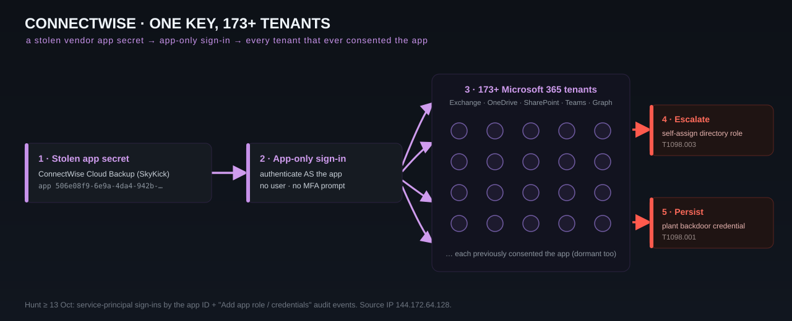

# Case 03 — ConnectWise Cloud Backup (SkyKick) → 173+ M365 Tenants

## Snapshot

| Field | Value |
|---|---|
| Disclosure | ConnectWise disclosed **16 October 2026**; discovered unauthorized access **14 Oct**; containment **17 Oct** |
| Vector | Stolen **application credential / API secret** for the ConnectWise Cloud Backup (formerly **SkyKick**) app |
| Impact | **173+** Microsoft 365 tenants with unauthorized sign-ins (162 on 16 Oct; some reporting 300+ Entra tenants) |
| Access gained | App-only (service principal) auth into Exchange Online, OneDrive, SharePoint, Teams, Graph, Partner Center |
| Escalation | Some ConnectWise Cloud Management apps **self-assigned directory/admin roles**; backdoor credentials planted in select tenants |
| Product CVE | **None** — abuse of a legitimately consented OAuth app identity |
| Status | Credentials reset 19 Oct; backups/restores for re-authorized tenants restored by ~4 Nov |

## What happened

ConnectWise Cloud Backup (bought as SkyKick) is a SaaS product MSPs use to back up customers' Microsoft 365 data. To do that it holds **broad, standing OAuth consent** across many tenants (mail, files, Teams, directory).

Between **13–15 October 2026**, attackers obtained the application's credential (an API secret) and authenticated **as the backup application itself** — an **app-only / service-principal** sign-in, no human user account or password needed — into customer M365 tenants. Huntress put it bluntly: assume **every** tenant with the app's ID consented is compromised. In some tenants, related ConnectWise Cloud Management apps were used to **grant themselves directory roles**, and attackers planted **backdoor credentials** (new client secrets / service-principal creds) for persistence.

Containment: ConnectWise disabled **seven application identities at 07:00 UTC on 17 October**, revoked certificates, invalidated shared credentials, and suspended Cloud Backup, SaaS Security, and Cloud Management.

## The play, on the board

<p align="center">
  
</p>

## Attack chain → MITRE ATT&CK

| Phase | Technique | ID |
|---|---|---|
| Initial access | Trusted-relationship / supply-chain app abuse | T1199 / T1195 |
| Credential access | Theft of application API secret | T1528 |
| Defense evasion / access | App-only sign-in as service principal (valid "account") | T1078.004 |
| Privilege escalation | Add app to privileged directory role | T1098.003 |
| Persistence | Add rogue client secret/credential to the app | T1098.001 |
| Collection | Read mail/files/Teams/SharePoint via Graph | T1114 / T1213 |

## Why it worked

- **The vendor app is a standing, over-privileged identity in every customer tenant.** One stolen secret = many tenants.
- **App-only auth doesn't trigger user-centric defenses** (no MFA prompt, no impossible-travel on a human).
- **MSP-style broad consent** means customers often don't know the app is even there (dormant SkyKick connections counted).

## Indicators of compromise

| Type | Value | Note |
|---|---|---|
| App ID (primary) | `506e08f9-6e9a-4da4-942b-a099a03644ae` | ConnectWise Cloud Backup (publisher SkyKick) |
| App ID (secondary) | `24205314-2b89-4e07-a2a4-579e898a5640` | ConnectWise Cloud Management – MS Teams |
| Permission of interest | `Directory.ReadWrite.All` | grant/abuse scope |
| Source IP | `144.172.64.128` | published source of unauthorized auth |
| Look-back date | **≥ 13 October 2026** | start your hunt here |

(Full list in `04_iocs/iocs.csv`.)

## Detection & hunting (Microsoft 365 / Entra)

Hunt **app-only sign-ins** and credential/role changes for the app IDs above since 13 Oct:

- Entra **sign-in logs** → service-principal sign-ins by the app IDs; correlate with source IP `144.172.64.128`.
- Entra **audit logs** → "Add service principal credentials," "Add app role assignment to service principal," "Add member to role" involving those apps.
- Graph activity / mailbox audit → unusual `Mail.Read` / `Files.Read.All` volume by the service principal.

KQL starting point (Entra sign-in logs):
```kql
AADServicePrincipalSignInLogs
| where TimeGenerated >= datetime(2026-10-13)
| where AppId in ("506e08f9-6e9a-4da4-942b-a099a03644ae","24205314-2b89-4e07-a2a4-579e898a5640")
   or IPAddress == "144.172.64.128"
| project TimeGenerated, AppId, ServicePrincipalName, IPAddress, ResourceDisplayName, ResultType
```
Audit-log role/credential changes:
```kql
AuditLogs
| where TimeGenerated >= datetime(2026-10-13)
| where OperationName in ("Add service principal credentials",
                          "Add app role assignment to service principal",
                          "Add member to role")
| where tostring(TargetResources) has_any ("506e08f9-6e9a-4da4-942b-a099a03644ae",
                                           "24205314-2b89-4e07-a2a4-579e898a5640","SkyKick","Cloud Backup")
```
See also `05_detections/sigma/connectwise_m365_app_signin.yml`.

## Mitigation

1. **In every tenant** (including dormant SkyKick connections): disable/remove the ConnectWise Cloud Backup app and the Cloud Management apps.
2. **Revoke app credentials and refresh tokens**; review and strip unexpected **app role assignments** and **added client secrets**.
3. **Hunt back to 13 Oct** for the sign-ins/role changes above; eradicate any planted backdoor credentials.
4. Re-consent only through ConnectWise's new app once you've verified it.
5. Going forward: inventory **all third-party enterprise apps** and their scopes; prefer least-privilege, per-tenant app registrations; alert on new service-principal credentials and privileged role grants.

## PoC / exploit status

No vulnerability PoC — this is credential theft + OAuth abuse. The reusable artifacts are the **IOCs, the KQL, and the Sigma rule** in this package.

## Red team takeaway

Map your **third-party app blast radius** before an engagement: which vendor service principals can read all mail or write to the directory, and what happens if one secret leaks? "Assume the vendor app is the attacker" is now a required threat-model branch.

## Sources

See `08_references.md` → "Case 03." Primary: ConnectWise Trust advisories; BleepingComputer (17 Oct); Huntress; SpecterOps; Field Effect; Rescana; Dark Reading.
