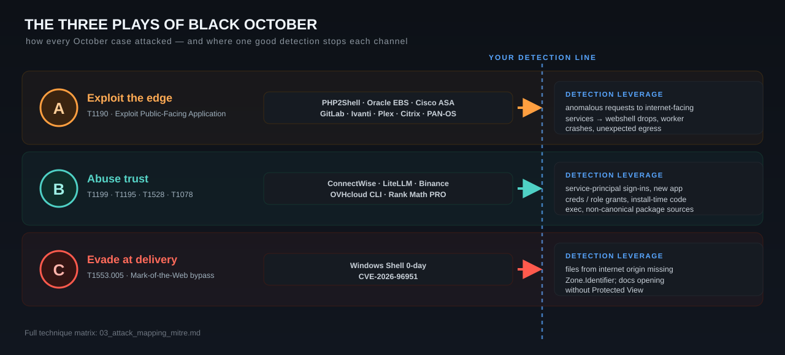

# MITRE ATT&CK Mapping — Black October 2026

A technique-centric view across all cases. Use it to prioritize detection coverage: the techniques that recur across multiple October incidents are where a single good detection pays off repeatedly.

## Techniques by frequency (where they showed up)

| Tactic | Technique | ID | Cases |
|---|---|---|---|
| Initial Access | Exploit Public-Facing Application | **T1190** | 05, 07, 08, 09, 10, 11 |
| Initial Access | Trusted Relationship | **T1199** | 03 |
| Initial Access | Supply Chain Compromise (software) | **T1195.002** | 04, 09, 11 |
| Initial Access | Phishing: Spearphishing via Service (fake interview) | **T1566.003** | 01 |
| Initial Access | Phishing (attachment/link) | T1566.001/.002 | 06 |
| Initial Access | Valid Accounts (VPN/cloud) | **T1078** | 02, 03 |
| Execution | Command & Scripting Interpreter | **T1059** | 01, 05, 07, 09, 10 |
| Execution | User Execution: Malicious File | T1204.002 | 01, 06 |
| Execution | Deploy Container | T1610 | 01 |
| Persistence | Account Manipulation (app creds / rogue admin) | **T1098** | 02, 03 |
| Persistence | Create Account (local) | T1136.001 | 02 |
| Persistence | Server Software Component: Web Shell | T1505.003 | 05, 10 |
| Persistence | Event-Triggered Exec: Python `.pth`/sitecustomize | **T1546** | 04 |
| Priv-Esc | Add app to privileged role | T1098.003 | 03 |
| Priv-Esc | Exploitation for Priv-Esc (Fragnesia→root) | T1068 | 05/11 |
| Defense Evasion | Subvert Trust Controls: **Mark-of-the-Web bypass** | **T1553.005** | 06 |
| Defense Evasion | Use Alternate Auth Material (app-only token) | T1550 | 03 |
| Credential Access | Brute Force (spray/stuff) | **T1110** | 02 |
| Credential Access | Steal App Access Token / OAuth | **T1528** | 03, 04 |
| Credential Access | Credentials from Password Stores / files | T1555/T1552 | 01, 04 |
| Credential Access | Unsecured Credentials (secret in repo, config) | **T1552.001** | 01, 04, 09 |
| Collection | Email/Data from Information Repositories | T1114/T1213 | 03 |
| Collection | Network Sniffing (on-box) | T1040 | 02 |
| Lateral Movement | Exploitation of Remote Services / tooling abuse | T1210/T1570 | 01 |
| C2 | Ingress Tool Transfer (remote loader) | T1105 | 04 |
| Exfiltration | Exfil Over C2 Channel | T1041 | 04 |
| Impact | Endpoint DoS | T1499.004 | 08 |
| Impact | Financial Theft | **T1657** | 01, 02, 07, 11 |

## The three dominant October patterns

  

**A. Exploit the edge (T1190).** The single most common initial-access technique this month — PHP, Oracle EBS, Cisco ASA/FTD, GitLab, Ivanti, Plex, Citrix, PAN-OS, Collabora. **Detection leverage:** anomalous requests to internet-facing services + post-exploit child processes/outbound. **Prevention leverage:** patch velocity + shrink the internet-facing surface.

**B. Abuse trust (T1199 / T1195 / T1528 / T1078).** ConnectWise, LiteLLM, Binance, OVHcloud CLI, Rank Math. The attacker arrives as a trusted app, package, or employee. **Detection leverage:** monitor service-principal sign-ins, new app credentials/role grants, install-time code execution, non-canonical package sources. **Prevention leverage:** least-privilege app scopes, short-lived/hardware-bound credentials, signed releases/provenance.

**C. Evade at delivery (T1553.005).** The MotW bypass made every phish quieter. **Detection leverage:** files from internet origins missing `Zone.Identifier`; documents opening without Protected View.

## Suggested detection coverage priority

1. Service-principal / OAuth app sign-ins and credential/role changes (covers Case 03; generalizes to all SaaS-app abuse).
2. Web-exploit post-conditions: webshell drops, worker crashes, unexpected outbound from web/app tiers (covers 05/07/09/10/11).
3. Install-time Python execution + package-source anomalies (covers 04; generalizes to supply chain).
4. MotW-stripped file execution (covers 06).
5. VPN/firewall credential-spray + config export + unexpected reloads (covers 02/08).
