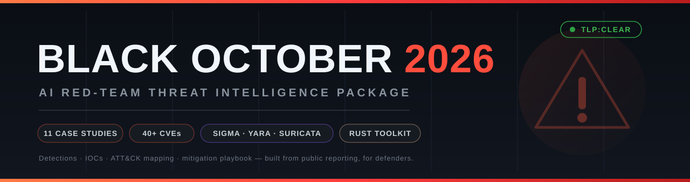
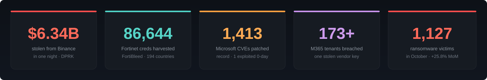
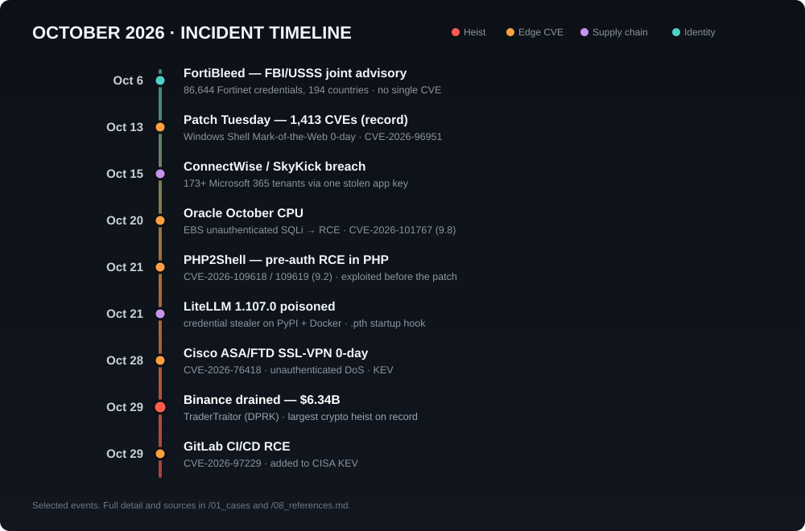

<!-- Black October 2026 — AI Red-Team Threat Intelligence Package -->

<p align="center">
  
</p>

<p align="center">
  
  
  
  
  
  
  
</p>

<p align="center">
  <b>A structured, defensive red-team intelligence package on the October 2026 &ldquo;Black October&rdquo; wave.</b><br>
  11 case studies · a CVE triage catalog · MITRE ATT&amp;CK mapping · machine-readable IOCs ·<br>
  Sigma / YARA / Suricata detections · a prioritized mitigation playbook · and a std-only Rust toolkit — in one repo.
</p>

---

## 📊 Black October by the numbers

<p align="center">
  
</p>

October 2026 was bad enough that the security press settled on a name for it: **&ldquo;Black October.&rdquo;** A record Patch Tuesday, the largest crypto heist in history, a credential dragnet against tens of thousands of firewalls, three separate open-source supply-chain poisonings, and a cluster of unauthenticated-RCE &ldquo;2Shell&rdquo; flaws all landed in the same four weeks. The defining theme: **trust turned into a weapon** — compromised developer laptops, poisoned packages, stolen vendor keys, and reused firewall passwords. The two biggest events involved **no product vulnerability at all**.

---

## 🗓️ Incident timeline

<p align="center">
  
</p>

---

## 📚 Table of contents

- [What this is (and isn&rsquo;t)](#-what-this-is-and-isnt)
- [Repository layout](#-repository-layout)
- [The cases](#-the-cases)
- [The three attack patterns (MITRE ATT&CK)](#-the-three-attack-patterns-mitre-attck)
- [Detections](#-detections)
- [The Rust toolkit](#-the-rust-toolkit)
- [Quick start by role](#-quick-start-by-role)
- [Top 10 priority actions](#-top-10-priority-actions)
- [References & sourcing](#-references--sourcing)
- [License & disclaimer](#-license--disclaimer)

---

## 🎯 What this is (and isn&rsquo;t)

This is a **blue-leaning red-team** package. It is built to help defenders and authorized red teams **understand, detect, hunt for, and remediate** the October 2026 activity.

> [!IMPORTANT]
> **Scope line.** This package describes how each attack worked at the level a detection engineer or IR lead needs, maps it to MITRE ATT&CK, and ships detection content + defensive tooling. For each vulnerability it points to the **official vendor advisory** and notes where public PoC code lives, so your team can retrieve and detonate it **in a lab you control**. It deliberately **does not** reproduce weaponized exploit code or stealer payloads. For a KEV-listed, actively-exploited flaw, a drop-in exploit helps the people spraying the internet more than the people trying to survive it. The Rust tooling is strictly defensive.

---

## 🗂️ Repository layout

```
black-october-2026/
├── README.md
├── 00_executive_summary.md        one-page brief for leadership
├── 01_cases/                      deep dive per incident (the core)
│   ├── 01_binance_traertraitor_heist.md
│   ├── 02_fortibleed_campaign.md
│   ├── 03_connectwise_cloud_backup.md
│   ├── 04_litellm_supply_chain.md
│   ├── 05_php2shell_rce.md
│   ├── 06_windows_shell_motw_zeroday.md
│   ├── 07_oracle_ebs_sqli.md
│   ├── 08_cisco_asa_ftd_dos.md
│   ├── 09_gitlab_cicd_rce.md
│   ├── 10_ivanti_connect_secure_chain.md
│   └── 11_black_october_vuln_wave.md
├── 02_cve_catalog.md              every CVE in one triage table
├── 03_attack_mapping_mitre.md     ATT&CK technique matrix
├── 04_iocs/                       machine-readable indicators (+ usage notes)
├── 05_detections/                 sigma/ · yara/ · suricata/
├── 06_rust_tooling/               defensive Cargo workspace
├── 07_mitigations_playbook.md     prioritized actions, by role
└── 08_references.md               every source, per case
```

Jump in: **[Executive summary](00_executive_summary.md)** · **[CVE catalog](02_cve_catalog.md)** · **[ATT&CK map](03_attack_mapping_mitre.md)** · **[IOCs](04_iocs/iocs.csv)** · **[Mitigation playbook](07_mitigations_playbook.md)**

---

## 🔍 The cases

| # | Case | Severity | Key identifier | What made it matter |
|---|------|----------|----------------|---------------------|
| 01 | [Binance / TraderTraitor heist](01_cases/01_binance_traertraitor_heist.md) | 🔴 Critical | _no CVE_ | $6.34B via a dev laptop + an abused internal **AI tool** + a standing deploy token |
| 02 | [FortiBleed](01_cases/02_fortibleed_campaign.md) | 🔴 Critical | _no CVE_ | 86,644 firewall creds; reused passwords + exposed mgmt planes, no patch fixes it |
| 03 | [ConnectWise Cloud Backup](01_cases/03_connectwise_cloud_backup.md) | 🔴 Critical | _app-key abuse_ | one stolen vendor OAuth key → app-only sign-in to 173+ M365 tenants |
| 04 | [LiteLLM 1.107.0 supply chain](01_cases/04_litellm_supply_chain.md) | 🔴 Critical | _PyPI + Docker_ | stealer running from a Python `.pth` hook **before any import** |
| 05 | [PHP2Shell](01_cases/05_php2shell_rce.md) | 🔴 9.2 | CVE-2026-109618/109619 | pre-auth RCE in the PHP runtime; exploited **before** the fix |
| 06 | [Windows Shell MotW 0-day](01_cases/06_windows_shell_motw_zeroday.md) | 🟠 8.8 | CVE-2026-96951 | Mark-of-the-Web bypass; lone exploited 0-day in a 1,413-CVE Patch Tuesday |
| 07 | [Oracle E-Business Suite](01_cases/07_oracle_ebs_sqli.md) | 🔴 9.8 | CVE-2026-101767 | unauth SQLi → RCE behind a default-allowed servlet; probed within a week |
| 08 | [Cisco ASA/FTD SSL-VPN](01_cases/08_cisco_asa_ftd_dos.md) | 🟠 8.6 | CVE-2026-76418 | unauth DoS reload of the VPN concentrator; no full workaround |
| 09 | [GitLab CI/CD RCE](01_cases/09_gitlab_cicd_rce.md) | 🔴 KEV | CVE-2026-97229 | unauth RCE in the software supply-chain control plane |
| 10 | [Ivanti Connect Secure](01_cases/10_ivanti_connect_secure_chain.md) | 🟠 8.6 | CVE-2026-104935 | UTA0576 unauth command-exec chain on the edge gateway |
| 11 | [The wider vuln & breach wave](01_cases/11_black_october_vuln_wave.md) | 🟠 mixed | _many_ | Plex2Shell, Arista, Citrix, PAN-OS, Brotli, EDK II, eMudhra, the big breaches |

🔴 Critical · 🟠 High · 🟣 Supply chain · 🟢 Identity/credential

---

## 🧬 The three attack patterns (MITRE ATT&CK)

Across every case, three patterns dominate. A single good detection on each pays off repeatedly — full matrix in **[03_attack_mapping_mitre.md](03_attack_mapping_mitre.md)**.

| Pattern | Core technique | Shows up in | Detection leverage |
|---|---|---|---|
| **A · Exploit the edge** | `T1190` Exploit Public-Facing App | PHP, Oracle EBS, Cisco, GitLab, Ivanti, Plex, Citrix, PAN-OS | anomalous requests to internet-facing services + post-exploit child processes / egress |
| **B · Abuse trust** | `T1199` / `T1195` / `T1528` / `T1078` | ConnectWise, LiteLLM, Binance, OVHcloud CLI | service-principal sign-ins, new app creds/role grants, install-time code exec, non-canonical package sources |
| **C · Evade at delivery** | `T1553.005` Mark-of-the-Web bypass | Windows Shell 0-day | files from internet origins missing `Zone.Identifier`; docs opening without Protected View |

---

## 🛡️ Detections

Ready-to-tune content under **[`05_detections/`](05_detections/)**:

- **Sigma** (6) — ConnectWise M365 app sign-in/role abuse, LiteLLM startup-hook + exfil domain, PHP2Shell post-exploitation, Windows Shell MotW bypass, FortiGate config-export, and a behavioral &ldquo;deploy credential used from an interactive session&rdquo; rule inspired by the Binance heist.
- **YARA** — LiteLLM `privcollect` artifacts (startup-hook loader, host markers, known-bad hashes) for hunting, not payload reconstruction.
- **Suricata** — exfil domain, breach source IPs, Arista attacker IPs, and heuristic PHP2Shell / Oracle EBS request patterns.
- **IOCs** — **[`04_iocs/iocs.csv`](04_iocs/iocs.csv)**, machine-readable, with a usage/caveats guide (context-sensitive filenames, `litellm.dev` ≠ `litellm.ai`).

---

## 🦀 The Rust toolkit

Three small, **dependency-free (std-only)** CLI tools under **[`06_rust_tooling/`](06_rust_tooling/)**. They read *your* inventory, logs, and files locally and report findings — nothing scans, attacks, or phones home.

```bash
cd 06_rust_tooling
cargo build --release      # no external crates, builds offline
cargo test                 # version-compare, SHA-256 vectors, log heuristics
```

| Tool | Does | Exit |
|---|---|---|
| **`kevcheck`** | compares an asset inventory against October 2026 fixed versions | `3` if any asset is below its fix (gate CI on it) |
| **`iocmatch`** | matches the IOC list against logs and file trees (in-crate SHA-256) | `3` on any hit |
| **`logtriage`** | flags web/access-log lines matching October exploitation patterns | `3` if any line flagged |

<details>
<summary><b>Sample <code>kevcheck</code> run</b> (click to expand)</summary>

```text
$ kevcheck --rules data/october2026_kev.tsv --inventory data/sample_inventory.csv

[VULNERABLE] web-prod-01   php-8.3   8.3.34 < fixed 8.3.36   CVE-2026-109618/109619  (critical-KEV)
             action: Patch then restart PHP workers (Case 05)
[VULNERABLE] ci-gitlab-01  gitlab    19.4.1 < fixed 19.4.2   CVE-2026-97229          (KEV)
[VULNERABLE] vpn-asa-01    cisco-asa-9.20  9.20.4.12 < fixed 9.20.4.50  CVE-2026-76418 (high-KEV)
...
summary: 7 vulnerable, 2 ok, 1 with no matching rule
```

</details>

Full usage in **[`06_rust_tooling/README.md`](06_rust_tooling/README.md)**.

---

## 🚀 Quick start by role

| You are… | Start here |
|---|---|
| **Leadership** (20 min) | [`00_executive_summary.md`](00_executive_summary.md) → skim the [CVE catalog](02_cve_catalog.md) |
| **IR / detection engineer** | your exposed [cases](01_cases/) → load [detections](05_detections/) → feed [IOCs](04_iocs/iocs.csv) to SIEM/EDR |
| **Vuln management** | run [`kevcheck`](06_rust_tooling/) on your inventory → drive the [playbook](07_mitigations_playbook.md) patch order |
| **Threat hunter** | run `iocmatch` + `logtriage` over retained logs for each case&rsquo;s exposure window |

---

## ✅ Top 10 priority actions

Full, role-tagged detail in **[07_mitigations_playbook.md](07_mitigations_playbook.md)**.

1. Patch **CVE-2026-96951** (Windows Shell MotW) everywhere — it leads phishing delivery.
2. Patch/restart **PHP** → 8.5.12 / 8.4.27 / 8.3.36 / 8.2.35 (PHP2Shell), restart workers after.
3. Audit every **M365** tenant for the ConnectWise Cloud Backup app and role grants since 13 Oct.
4. Rotate every secret any host that ran **LiteLLM 1.107.0** could read; purge the Docker tags.
5. Get internet-facing **FortiGate** mgmt/SSL-VPN off the public internet; rotate creds; enforce MFA.
6. Upgrade **Cisco ASA/FTD** to fixed releases (no full workaround for CVE-2026-76418).
7. Patch **GitLab** → 19.2.8 / 19.3.5 / 19.4.2 (KEV since 29 Oct).
8. Patch **Ivanti Connect Secure** → 25.1.1.3 / 22.8R2.6 (UTA0576 chain).
9. Apply the **Oracle October CPU** to EBS 12.2.3–12.2.15 (unauth SQLi → RCE, CVSS 9.8).
10. Hunt the whole estate with `04_iocs/iocs.csv` + the Rust `iocmatch` / `logtriage` tools.

---

## 📖 References & sourcing

Every figure, CVE, date, and indicator is attributed in **[08_references.md](08_references.md)**, organized per case. The package **paraphrases and attributes** — it does not reproduce source text. Vendor advisories are the authoritative record for versions, timelines, and IOCs; always prefer them over secondary reporting, and **re-check [CISA KEV](https://www.cisa.gov/known-exploited-vulnerabilities-catalog) before deprioritizing anything**. Several of these cases were still developing as of early November 2026.

---

## ⚖️ License & disclaimer

Built entirely from **public reporting (TLP:CLEAR)** — safe to share. This material is provided **for defensive and educational use**. Use the tooling and guidance only on systems you are **authorized** to assess. Nothing here is legal, financial, or professional security advice; validate against vendor advisories and your own environment before acting.

<p align="center"><sub>Compiled as an AI red-team lead deliverable · built for defenders.</sub></p>
